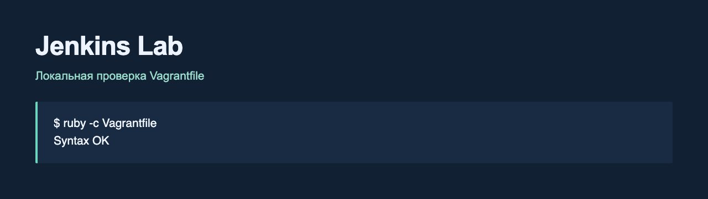
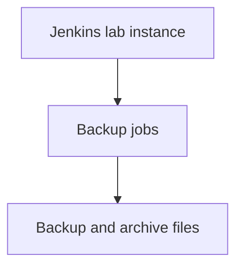

# Jenkins Backup Lab

A 2018 practice repository for a Jenkins backup workflow. It contains an Ubuntu Trusty Vagrant definition and examples of Jenkins backup and archive jobs.

[Demo](#demo) · [Repository map](#repository-map) · [PDF slides](docs/readme/overview.pdf) · [AGENTS.md](AGENTS.md)

## Demo



Local Ruby syntax check of the Vagrantfile.

1. Validate the Vagrantfile without starting a VM.
2. Inspect the job definitions to see how backups were created and archived.
3. Use a disposable environment if you need to reproduce the historical VM.

## How it works



## Repository map

| File or directory | Purpose |
| --- | --- |
| [`Vagrantfile`](Vagrantfile) | Ubuntu Trusty VM definition |
| [`jenkins-bkp/jobs`](jenkins-bkp/jobs) | Saved job definitions for backup and archiving |

## Inspect the lab

```sh
ruby -c Vagrantfile
```

The Vagrantfile selects `ubuntu/trusty64`. Jenkins requires a separate installation. The saved jobs were created for an earlier Jenkins environment. Keep any replay isolated and review the job configuration before running it.
